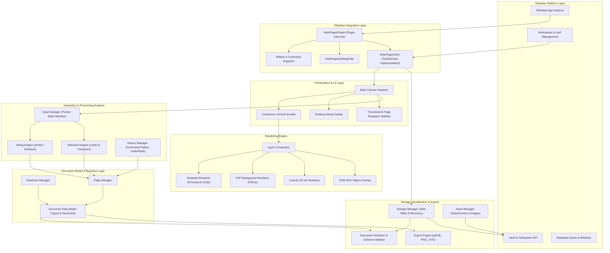
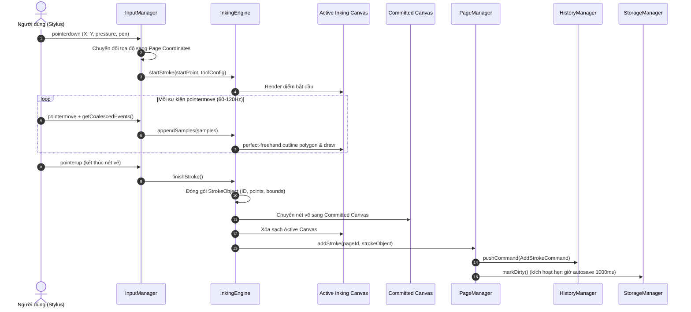

# Architecture Specification — Obsidian NotePages

Tài liệu này định nghĩa cấu trúc phân tầng, phân rã trách nhiệm giữa các module, sơ đồ luồng dữ liệu và giao diện nội bộ (Internal Interfaces) của plugin Obsidian NotePages.

---

## 1. Sơ đồ kiến trúc tổng thể (Mermaid Architecture Diagram)



---

## 2. Phân rã trách nhiệm các Module (Module Decomposition)

### 2.1. Plugin Core (`NotePagesPlugin`)
- **Trách nhiệm**: Điểm khởi đầu của plugin (Entry Point kế thừa từ `Plugin`). Quản lý vòng đời (Lifecycle) từ `onload()` đến `onunload()`. Đăng ký View Type, lệnh Command Palette, nút Ribbon icon và bảng cài đặt Settings Tab.
- **Phụ thuộc**: Obsidian API (`Plugin`, `WorkspaceLeaf`, `TFile`).
- **Giao tiếp**: Khởi tạo và kết nối các dịch vụ dùng chung trong suốt phiên chạy của plugin.

### 2.2. Notebook Manager & Page Manager
- **Trách nhiệm**:
  - `NotebookManager`: Quản lý thực thể notebook ở mức vĩ mô (danh sách trang, thông tin metadata, kích thước mặc định, trạng thái dirty).
  - `PageManager`: Quản lý các thao tác trên trang cụ thể: thêm trang mới, nhân bản trang, xóa trang, sắp xếp lại thứ tự (reorder), tính toán vị trí tọa độ Y tích lũy của từng trang trong không gian cuộn liên tục.
- **Phụ thuộc**: `DocumentModel`.
- **Giao tiếp**: Cung cấp API cho `MainCanvasView` và `HistoryManager`.

### 2.3. Document Model (`DocumentDataModel`)
- **Trách nhiệm**: Định nghĩa cấu trúc dữ liệu thuần túy (Plain Old JavaScript Object / TypeScript Type) biểu diễn toàn bộ trạng thái tài liệu: danh sách trang, mẫu giấy, các nét vẽ, hộp văn bản, ảnh và liên kết.
- **Nguyên tắc**: Độc lập hoàn toàn với DOM, Canvas và Obsidian API. Có tính tương thích hai chiều và quản lý phiên bản `schemaVersion`.

### 2.4. Rendering Engine
- **Trách nhiệm**: Điều phối kết xuất các lớp hình ảnh lên màn hình theo từng trang:
  - `LayerCompositor`: Quản lý các khung canvas và thẻ chứa SVG/DOM cho mỗi trang.
  - `TemplateRenderer`: Vẽ lưới chấm, dòng kẻ, bố cục Cornell bằng Canvas 2D theo kích thước vật lý.
  - `CanvasInkRenderer`: Kết xuất các nét vẽ đã hoàn thành (committed strokes) bằng `CanvasRenderingContext2D`.
  - `RichObjectRenderer`: Quản lý các thẻ DOM chứa nội dung văn bản có thể chỉnh sửa và liên kết Wikilink.
  - `PDFRenderer`: Gọi PDF.js để vẽ trang PDF nền.
- **Phụ thuộc**: `DocumentModel`, `PageManager`.

### 2.5. Inking Engine
- **Trách nhiệm**: Tiếp nhận các điểm tọa độ thô kèm áp lực bút (`PointSample`), chuyển đổi thành đường bao vector mượt mà thông qua thư viện `perfect-freehand`, kết xuất nét vẽ tức thì lên `Active Inking Canvas` và đóng gói thành đối tượng `Stroke` hoàn chỉnh khi kết thúc nét vẽ.
- **Phụ thuộc**: `perfect-freehand`.

### 2.6. Input Manager
- **Trách nhiệm**: Quản lý sự kiện Pointer Events (`pointerdown`, `pointermove`, `pointerup`, `pointercancel`). Phân loại loại phần cứng (`pen`, `touch`, `mouse`), xử lý chống tì tay (palm rejection), chuyển đổi tọa độ từ màn hình sang tọa độ trang cục bộ, và điều hướng sự kiện đến `InkingEngine` hoặc `SelectionEngine`.
- **Phụ thuộc**: Không phụ thuộc logic hiển thị.

### 2.7. Selection Engine
- **Trách nhiệm**:
  - Tính toán kiểm tra va chạm (Hit Testing) giữa điểm chạm hoặc vùng chọn với các đối tượng trên trang.
  - Quản lý công cụ Lasso (vùng chọn đa giác tự do) và Bounding Box.
  - Thực hiện các phép biến đổi hình học: Dịch chuyển (Translation), Co giãn (Scaling), Xoay (Rotation).
- **Phụ thuộc**: `DocumentModel`, `HistoryManager`.

### 2.8. History Manager
- **Trách nhiệm**: Quản lý ngăn xếp Undo/Redo dựa trên mẫu thiết kế Command Pattern. Mỗi thao tác (vẽ nét, xóa nét, di chuyển, đổi thứ tự trang) được đóng gói thành một đối tượng `Command` có hàm `execute()` và `undo()`. Giới hạn kích thước ngăn xếp để kiểm soát bộ nhớ.
- **Phụ thuộc**: `DocumentModel`.

### 2.9. Serializer & Storage Manager
- **Trách nhiệm**:
  - `Serializer`: Chuyển đổi hai chiều giữa chuỗi văn bản Markdown/JSON và đối tượng `DocumentModel`. Xác thực dữ liệu đầu vào bằng schema Zod.
  - `StorageManager`: Tương tác với Obsidian Vault API. Điều phối cơ chế lưu tự động không chặn (debounced autosave), khóa bảo vệ chống ghi đồng thời (mutex), và cơ chế khôi phục tệp khi gặp sự cố.
- **Phụ thuộc**: Obsidian Vault API, Zod.

### 2.10. Asset Manager
- **Trách nhiệm**: Quản lý các tệp đính kèm nhị phân (hình ảnh, tài liệu PDF). Lưu trữ các tệp này trong thư mục đính kèm được quy định của Obsidian Vault và quản lý đường dẫn tương đối để đảm bảo tài liệu không bị đứt liên kết khi di chuyển vault.
- **Phụ thuộc**: Obsidian Vault API, Metadata Cache.

### 2.11. Export Engine
- **Trách nhiệm**: Kết xuất tài liệu thành các tệp độc lập không phụ thuộc vào trạng thái zoom/scroll của màn hình:
  - Xuất PDF: Sử dụng thư viện `pdf-lib` để tạo tệp PDF vector nhiều trang với đúng tỉ lệ kích thước vật lý A4/Letter.
  - Xuất PNG/SVG: Kết xuất từng trang hoặc toàn bộ notebook ra ảnh raster hoặc file vector SVG chuẩn.

---

## 3. Định nghĩa Giao diện nội bộ cốt lõi (Core Internal Interfaces)

```typescript
export type PageSizePreset = 'A4' | 'Letter' | 'Custom';
export type PageOrientation = 'portrait' | 'landscape';
export type ToolType = 'pen' | 'fountain' | 'highlighter' | 'eraser' | 'lasso' | 'text' | 'shape';

export interface PageDimensions {
    width: number;
    height: number;
    unit: 'pt';
}

export interface PointSample {
    x: number;
    y: number;
    pressure: number;
    timestamp: number;
    tiltX?: number;
    tiltY?: number;
}

export interface StrokeBoundingBox {
    minX: number;
    minY: number;
    maxX: number;
    maxY: number;
}

export interface StrokeObject {
    id: string;
    tool: ToolType;
    color: string;
    width: number;
    opacity: number;
    points: PointSample[];
    bounds: StrokeBoundingBox;
    createdAt: number;
}

export interface ShapeObject {
    id: string;
    type: 'line' | 'circle' | 'ellipse' | 'rectangle' | 'triangle';
    color: string;
    strokeWidth: number;
    fillColor?: string;
    bounds: StrokeBoundingBox;
    geometryData: Record<string, number>;
}

export interface TextObject {
    id: string;
    x: number;
    y: number;
    width: number;
    height: number;
    content: string;
    fontSize: number;
    fontFamily: string;
    fontWeight: string;
    color: string;
    textAlign: 'left' | 'center' | 'right';
}

export interface ImageObject {
    id: string;
    assetId: string;
    vaultPath: string;
    x: number;
    y: number;
    width: number;
    height: number;
    rotation: number;
}

export interface PaperTemplateConfig {
    type: 'blank' | 'ruled' | 'grid' | 'dotted' | 'cornell';
    backgroundColor: string;
    lineColor: string;
    spacing: number;
    opacity: number;
}

export interface PageData {
    id: string;
    pageNumber: number;
    dimensions: PageDimensions;
    orientation: PageOrientation;
    template: PaperTemplateConfig;
    pdfSource?: {
        pdfPath: string;
        pageIndex: number;
    };
    strokes: StrokeObject[];
    shapes: ShapeObject[];
    texts: TextObject[];
    images: ImageObject[];
}

export interface NotebookMetadata {
    title: string;
    createdAt: number;
    updatedAt: number;
    schemaVersion: number;
    defaultPageSize: PageSizePreset;
    defaultOrientation: PageOrientation;
}

export interface NotebookDocument {
    metadata: NotebookMetadata;
    pages: PageData[];
}
```

---

## 4. Giao diện thực thi lệnh (Command Pattern Interfaces)

```typescript
export interface Command {
    id: string;
    name: string;
    execute(): Promise<void> | void;
    undo(): Promise<void> | void;
}

export interface HistoryState {
    canUndo: boolean;
    canRedo: boolean;
    undoCount: number;
    redoCount: number;
}
```

---

## 5. Sơ đồ tuần tự: Quy trình xử lý nét vẽ (Sequence Diagram)


