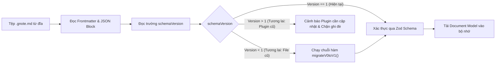

# Data Format & Schema Specification — Obsidian NotePages

Tài liệu này đặc tả định dạng tệp lưu trữ, cấu trúc dữ liệu JSON, cơ chế tương thích ngược (Backward Compatibility), chiến lược quản lý tệp đính kèm và phần hiển thị dự phòng (Markdown Preview Fallback).

---

## 1. So sánh các phương án định dạng lưu trữ (File Format Comparison)

| Tiêu chí đánh giá | Phương án 1: Một tệp `.gnote.md` chứa tất cả (Nhúng Base64) | Phương án 2: Tệp `.gnote.md` kèm thư mục tài nguyên ngoài | Phương án 3: Thư mục gói tài liệu (File Bundle / Multi-file) |
|---|---|---|---|
| **Cấu trúc lưu trữ** | Toàn bộ metadata, vector nét vẽ và ảnh base64 nằm trong 1 tệp Markdown | 1 tệp `.gnote.md` lưu cấu trúc vector; hình ảnh và PDF lưu trong thư mục đính kèm của Vault | 1 thư mục chứa `manifest.json`, `page1.json`, `page2.json`, thư mục con `assets/` |
| **Tính tương thích Obsidian** | Cao (chỉ là 1 file `.md`) | **Hoàn hảo** (chuẩn quy ước tệp Markdown + thư mục Attachment của Obsidian) | Kém (Obsidian không có khái niệm Bundle File như macOS; người dùng sẽ thấy một thư mục đầy tệp vụn) |
| **Tương thích Obsidian Sync & Git** | Kém (Tệp phình to hàng chục MB; mỗi nét vẽ làm git diff khổng lồ do chuỗi base64) | **Tối ưu nhất** (Diff nhỏ gọn, chỉ thay đổi mảng tọa độ vector; ảnh chỉ đồng bộ 1 lần duy nhất) | Trung bình (Nhiều tệp nhỏ gây tăng số lượng request đồng bộ) |
| **Hiệu năng đọc/ghi** | Kém khi có nhiều hình ảnh | **Cao** (Kích thước tệp vector thường dưới 500KB cho 50 trang) | Tốt cho từng trang, nhưng phức tạp khi đồng bộ trạng thái tổng thể |
| **Markdown Preview Fallback** | Có thể hiển thị ảnh thô | **Rất tốt** (Hiển thị được danh sách trang, ảnh trích xuất và liên kết Wikilink) | Khó hiển thị liền mạch dưới dạng một ghi chú đơn lẻ |
| **Quyết định** | Loại | **ĐƯỢC CHỌN LÀM ĐỊNH DẠNG CHUẨN** | Loại |

---

## 2. Cấu trúc tệp `.gnote.md` hoàn chỉnh

Tệp `.gnote.md` được cấu tạo gồm 3 phần rõ ràng:
1. **YAML Frontmatter**: Chứa metadata phục vụ hệ thống chỉ mục (Index) của Obsidian, phiên bản schema và cờ nhận diện plugin.
2. **Markdown Preview Fallback Section**: Đoạn văn bản Markdown tiêu chuẩn giúp người dùng có thể đọc tóm tắt nội dung khi xem trên Obsidian Mobile chưa bật plugin hoặc trên trình xem Markdown bất kỳ.
3. **Structured Payload Block**: Khối mã độc quyền được bao bọc bởi thẻ định danh ```` ```notepages-data ... ``` ```` chứa toàn bộ dữ liệu vector của notebook dưới định dạng JSON nén có cấu trúc.

### Ví dụ cấu trúc một tệp `.gnote.md`:

````markdown
---
notepages-plugin: true
notepages-version: 1
title: "Bài giảng Giải tích 1"
created: 1730268000000
updated: 1730271600000
page-count: 2
tags:
  - math
  - lecture-notes
---

> [!NOTE] Thông tin sổ tay NotePages
> Đây là sổ tay viết tay kỹ thuật số được tạo bởi plugin **Obsidian NotePages**.
> - Số trang: 2 trang (A4 Dọc)
> - Cập nhật lần cuối: 2026-10-30 13:30:00
> - Liên kết trong tài liệu: [[Định lý Lagrange]], [[Giải tích nâng cao]]

```notepages-data
{
  "schemaVersion": 1,
  "metadata": {
    "title": "Bài giảng Giải tích 1",
    "createdAt": 1730268000000,
    "updatedAt": 1730271600000,
    "defaultPageSize": "A4",
    "defaultOrientation": "portrait"
  },
  "pages": [
    {
      "id": "page_c8d9e0f1",
      "pageNumber": 1,
      "dimensions": {
        "width": 595.28,
        "height": 841.89,
        "unit": "pt"
      },
      "orientation": "portrait",
      "template": {
        "type": "ruled",
        "backgroundColor": "#ffffff",
        "lineColor": "#e2e8f0",
        "spacing": 24,
        "opacity": 0.8
      },
      "strokes": [
        {
          "id": "stroke_a1b2c3d4",
          "tool": "pen",
          "color": "#1e293b",
          "width": 2.5,
          "opacity": 1.0,
          "bounds": {
            "minX": 100.5,
            "minY": 150.2,
            "maxX": 220.8,
            "maxY": 180.4
          },
          "points": [
            { "x": 100.5, "y": 150.2, "pressure": 0.5, "timestamp": 1730268010000 },
            { "x": 150.1, "y": 165.0, "pressure": 0.7, "timestamp": 1730268010016 },
            { "x": 220.8, "y": 180.4, "pressure": 0.4, "timestamp": 1730268010032 }
          ],
          "createdAt": 1730268010000
        }
      ],
      "shapes": [],
      "texts": [
        {
          "id": "text_f5e4d3c2",
          "x": 72.0,
          "y": 80.0,
          "width": 300.0,
          "height": 40.0,
          "content": "Chương 1: Giới hạn và Đạo hàm [[Định lý Lagrange]]",
          "fontSize": 18,
          "fontFamily": "Inter, sans-serif",
          "fontWeight": "bold",
          "color": "#0f172a",
          "textAlign": "left"
        }
      ],
      "images": []
    }
  ]
}
```
````

---

## 3. Đặc tả lược đồ dữ liệu (JSON Schema Specification)

### 3.1. Đơn vị đo kích thước vật lý
- Hệ thống quy định chuẩn kích thước tọa độ là **Points (pt)**:
  - $1 \text{ inch} = 72 \text{ pt} = 25.4 \text{ mm}$.
  - Khổ giấy A4 Portrait: $595.28 \text{ pt} \times 841.89 \text{ pt}$ ($210 \text{ mm} \times 297 \text{ mm}$).
  - Khổ giấy US Letter Portrait: $612.00 \text{ pt} \times 792.00 \text{ pt}$ ($8.5 \text{ inch} \times 11.0 \text{ inch}$).

### 3.2. Cấu trúc chi tiết từng thực thể

#### 1. Notebook Metadata
| Trường | Kiểu dữ liệu | Bắt buộc | Mô tả |
|---|---|---|---|
| `schemaVersion` | `number` | Có | Số phiên bản của schema (bắt đầu từ `1`). |
| `title` | `string` | Có | Tên tài liệu notebook. |
| `createdAt` | `number` | Có | Timestamp thời điểm tạo (Unix epoch ms). |
| `updatedAt` | `number` | Có | Timestamp thời điểm sửa đổi gần nhất. |
| `defaultPageSize`| `'A4' \| 'Letter' \| 'Custom'` | Có | Khổ giấy mặc định khi thêm trang mới. |
| `defaultOrientation` | `'portrait' \| 'landscape'` | Có | Hướng trang mặc định. |

#### 2. Page Entity
| Trường | Kiểu dữ liệu | Bắt buộc | Mô tả |
|---|---|---|---|
| `id` | `string` | Có | Mã định danh duy nhất (UUID/NanoID) của trang. Không thay đổi khi di chuyển. |
| `pageNumber` | `number` | Có | Thứ tự hiển thị hiện tại của trang (bắt đầu từ `1`). |
| `dimensions` | `object` | Có | Chứa `width`, `height`, và `unit` (`pt`). |
| `orientation` | `'portrait' \| 'landscape'` | Có | Hướng trang cụ thể của trang này. |
| `template` | `object` | Có | Cấu hình mẫu giấy (blank, ruled, grid, dotted, cornell). |
| `pdfSource` | `object` | Không | Thông tin trang PDF nền (nếu có): `pdfPath` và `pageIndex`. |
| `strokes` | `StrokeObject[]` | Có | Danh sách nét vẽ tay trên trang. |
| `shapes` | `ShapeObject[]` | Có | Danh sách hình học đã nhận diện hoặc vẽ vector. |
| `texts` | `TextObject[]` | Có | Danh sách hộp văn bản và liên kết. |
| `images` | `ImageObject[]` | Có | Danh sách ảnh nhúng trên trang. |

#### 3. Stroke Entity
| Trường | Kiểu dữ liệu | Bắt buộc | Mô tả |
|---|---|---|---|
| `id` | `string` | Có | ID duy nhất của nét vẽ. |
| `tool` | `string` | Có | Loại bút (`pen`, `fountain`, `highlighter`). |
| `color` | `string` | Có | Mã màu HEX hoặc RGBA (ví dụ `#000000`, `rgba(255,235,59,0.5)`). |
| `width` | `number` | Có | Bán kính hoặc độ dày cơ bản của nét vẽ (đơn vị pt). |
| `opacity` | `number` | Có | Độ trong suốt từ `0.0` đến `1.0`. |
| `bounds` | `object` | Có | Tọa độ hộp bao (`minX`, `minY`, `maxX`, `maxY`) phục vụ hit-test nhanh. |
| `points` | `PointSample[]` | Có | Danh sách các điểm mẫu (tọa độ x, y, áp lực, mốc thời gian). |

#### 4. Point Sample Structure
Mỗi điểm trong mảng `points` bao gồm:
- `x`: Tọa độ X trên trang (pt, độ chính xác 2 chữ số thập phân).
- `y`: Tọa độ Y trên trang (pt, độ chính xác 2 chữ số thập phân).
- `pressure`: Lực nhấn từ bút cảm ứng (từ `0.0` đến `1.0`; nếu thiết bị không hỗ trợ thì mặc định `0.5`).
- `timestamp`: Thời gian tính từ lúc bắt đầu nét vẽ hoặc Unix epoch.

---

## 4. Quản lý tài nguyên nhị phân (Asset References Policy)

1. **Tuyệt đối không lưu dữ liệu Base64 trong tệp JSON**:
   - Mọi tệp ảnh hoặc tệp PDF được đưa vào notebook phải được lưu thành tệp độc lập trong thư mục đính kèm của Vault (Attachment folder được định cấu hình trong cài đặt Obsidian).
2. **Quy tắc đường dẫn tương đối (Vault-Relative Paths)**:
   - Thuộc tính `vaultPath` trong `ImageObject` hoặc `pdfSource` luôn sử dụng đường dẫn tương đối tính từ gốc Vault (ví dụ: `attachments/notepages/img_20261030_123456.png`).
   - Điều này đảm bảo khi người dùng di chuyển toàn bộ Vault sang máy tính hoặc hệ điều hành khác, các liên kết tài nguyên vẫn tồn tại chính xác mà không bị gãy (broken links).

---

## 5. Chiến lược phiên bản và nâng cấp dữ liệu (Schema Migration Strategy)



### Nguyên tắc bất biến khi chuyển đổi dữ liệu (Migration Invariants):
1. Không sửa đổi dữ liệu gốc nếu quá trình di chuyển gặp lỗi.
2. Hàm nâng cấp (Migration function) phải là hàm thuần túy (Pure Function): `migrate(oldData: unknown): TargetData`.
3. Có bộ kiểm thử hồi quy tự động (Regression Tests) cho toàn bộ các phiên bản schema trong lịch sử phát triển.
