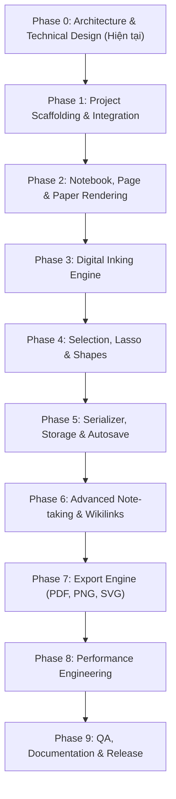

# Development Roadmap — Obsidian NotePages

Lộ trình phát triển được chia thành 10 giai đoạn (Phases 0–9). Mỗi giai đoạn có mục tiêu độc lập, ranh giới rõ ràng, tiêu chí nghiệm thu chặt chẽ và không được chuyển giai đoạn khi chưa được người dùng kiểm tra và phê duyệt.

---

## Tổng quan tiến độ (Roadmap Overview)

---

## Chi tiết từng giai đoạn phát triển

### Phase 0: Architecture & Technical Design
- **Mục tiêu**: Phân tích toàn diện yêu cầu, công nghệ, định dạng tệp, giải quyết các mâu thuẫn kỹ thuật và thiết kế cấu trúc module trước khi viết code.
- **Kết quả bàn giao**:
  - `docs/TECHNICAL_DESIGN.md`
  - `docs/ARCHITECTURE.md`
  - `docs/DATA_FORMAT.md`
  - `docs/ROADMAP.md`
  - `docs/DECISIONS.md`
- **Tiêu chí nghiệm thu (Acceptance Criteria)**:
  - Tất cả các câu hỏi kiến trúc cốt lõi được giải quyết rõ ràng.
  - Người dùng xem xét và phê duyệt các quyết định kiến trúc.
- **Trạng thái**: Đang hoàn thành và chờ nghiệm thu.

---

### Phase 1: Project Scaffolding & Obsidian Integration
- **Mục tiêu**: Thiết lập hạ tầng phát triển với TypeScript strict, esbuild, manifest của Obsidian, đăng ký View và vòng đời plugin.
- **Nội dung chính**:
  - Cấu hình `tsconfig.json`, `esbuild.config.mjs`, `package.json`, `manifest.json`.
  - Khởi tạo lớp `NotePagesPlugin` và đăng ký lệnh mở tài liệu, biểu tượng trên Ribbon.
  - Khởi tạo lớp `NotePagesView` kế thừa từ `TextFileView`.
  - Xây dựng layout tối thiểu: vùng cuộn chính, khung chứa trang giấy A4 đơn lập.
  - Hỗ trợ các biến màu CSS từ theme của Obsidian.
- **Tiêu chí nghiệm thu**:
  - Chạy lệnh build không có lỗi TypeScript strict.
  - Plugin kích hoạt thành công trong Obsidian, mở được tệp mẫu hiển thị trang trắng A4.
  - Đóng view và tắt plugin giải phóng sạch tài nguyên, không gây rò rỉ listener.

---

### Phase 2: Notebook, Page & Paper Rendering
- **Mục tiêu**: Xây dựng mô hình dữ liệu đa trang (Multi-page Notebook) và kết xuất các mẫu giấy theo chuẩn kích thước vật lý.
- **Nội dung chính**:
  - Triển khai typed model cho `Notebook`, `Page`, `PaperTemplate`.
  - Hỗ trợ khổ giấy A4, Letter, Custom; chiều dọc và chiều ngang với tỉ lệ chính xác.
  - Triển khai bộ sinh mẫu giấy thủ tục (Procedural Template Renderer): Blank, Ruled, Grid, Dotted, Cornell.
  - Cơ chế cuộn dọc liên tục (Continuous vertical scrolling).
  - Quản lý trang: Thêm trang, xóa trang, nhân bản trang, kéo thả đổi thứ tự trang.
  - Thanh thanh điều hướng trang và thumbnail sidebar.
- **Tiêu chí nghiệm thu**:
  - Nhiều trang hiển thị nối tiếp nhau theo chiều dọc mượt mà.
  - Thao tác thêm/xóa/đổi thứ tự trang bảo toàn chính xác dữ liệu của từng trang.
  - Bộ kiểm thử đơn vị chuyển đổi tọa độ (Coordinate Transform Tests) pass 100%.

---

### Phase 3: Digital Inking Engine
- **Mục tiêu**: Hiện thực hóa hệ thống viết tay kỹ thuật số với độ trễ thấp và độ chính xác cao.
- **Nội dung chính**:
  - Xử lý sự kiện Pointer Events (`pointerdown`, `pointermove`, `pointerup`, `pointercancel`) và tích hợp `getCoalescedEvents()`.
  - Triển khai kiến trúc 2 lớp Canvas: `Active Inking Canvas` (vẽ nét đang rê) và `Committed Inking Canvas` (lưu nét đã vẽ).
  - Tích hợp thư viện `perfect-freehand` để sinh đường bao nét vẽ mượt mà.
  - Hiện thực hóa các loại bút: Ballpoint Pen, Pressure Pen, Fountain Pen, Highlighter.
  - Hiện thực hóa Stroke Eraser và Precision Eraser.
  - Thanh công cụ Inking Toolbar nổi: chọn bút, chọn màu, chỉnh độ dày nét.
- **Tiêu chí nghiệm thu**:
  - Vẽ mượt mà bằng bút cảm ứng và chuột; nét vẽ có độ dày biến thiên theo lực nhấn.
  - Chuyển đổi công cụ tức thời, không làm mất nét vẽ cũ.
  - Công cụ tẩy xóa chính xác đối tượng mục tiêu.

---

### Phase 4: Selection, Lasso & Shape Recognition
- **Mục tiêu**: Cung cấp khả năng lựa chọn, biến đổi hình học và nhận diện hình vẽ tay.
- **Nội dung chính**:
  - Chuẩn hóa giao diện đối tượng đồ họa (`StrokeObject`, `ShapeObject`, `TextObject`, `ImageObject`).
  - Lập chỉ mục không gian (Spatial Indexing) để hit-test nhanh.
  - Công cụ chọn Bounding Box và Lasso đa giác tự do.
  - Thao tác biến đổi: Di chuyển (Move), Co giãn (Resize), Xoay (Rotate), Nhân bản (Duplicate), Xóa (Delete).
  - Thuật toán nhận diện hình học: Đoạn thẳng, hình tròn, elip, hình chữ nhật, tam giác từ nét vẽ tay kèm cơ chế giữ bút (hold-to-snap).
  - Hệ thống Undo/Redo đa cấp theo mẫu thiết kế Command Pattern.
- **Tiêu chí nghiệm thu**:
  - Lasso chọn đúng các nét vẽ nằm trong vùng khoanh, không chọn nhầm nét bên ngoài.
  - Nhận diện hình chính xác, cho phép hoàn tác ngay để lấy lại nét vẽ tay gốc.
  - Undo/Redo khôi phục chính xác trạng thái của mọi thao tác.

---

### Phase 5: Serializer, Storage & Autosave
- **Mục tiêu**: Xây dựng hệ thống lưu trữ bền vững, chống mất dữ liệu và tự động lưu an toàn.
- **Nội dung chính**:
  - Triển khai bộ phân tích cú pháp hai chiều `serializeDocument` và `deserializeDocument`.
  - Xác thực cấu trúc schema bằng Zod trước khi ghi dữ liệu.
  - Cơ chế Autosave an toàn: Debounce 1000ms, hàng đợi tuần tự (Mutex lock) chống xung đột ghi đè.
  - Bảo vệ dữ liệu khi tệp bị lỗi: Giữ nguyên tệp gốc, không ghi đè dữ liệu rỗng.
  - Cơ chế nâng cấp schema tự động (Schema Migrations).
- **Tiêu chí nghiệm thu**:
  - Mở, sửa, lưu, đóng và mở lại tệp bảo toàn 100% chi tiết của notebook.
  - Các bài kiểm tra lưu trữ mô phỏng lỗi (Simulated write failure) không làm mất dữ liệu.

---

### Phase 6: Advanced Note-taking & Obsidian Integration
- **Mục tiêu**: Tích hợp các tính năng ghi chép nâng cao và liên kết sâu vào hệ sinh thái Obsidian.
- **Nội dung chính**:
  - Hộp văn bản động (Rich Text Box): Định dạng phong phú, chỉnh font chữ, màu sắc.
  - Nhúng công thức toán học LaTeX (MathJax/KaTeX).
  - Quản lý hình ảnh: Chèn ảnh từ Vault, di chuyển, thay đổi kích thước.
  - Tích hợp liên kết Obsidian Wikilinks: Nhấp chuột để mở ghi chú khác trong Vault.
  - Nền tảng ghi chú trên tệp PDF (PDF Background Annotation) sử dụng PDF.js.
- **Tiêu chí nghiệm thu**:
  - Văn bản và ảnh lưu trữ chính xác và chỉnh sửa lại được sau khi mở lại tệp.
  - Wikilink điều hướng chính xác trong workspace Obsidian.
  - Trang PDF gốc giữ nguyên vẹn; nét vẽ tay đè lên trang hiển thị đúng vị trí.

---

### Phase 7: Export Engine
- **Mục tiêu**: Xuất tài liệu ra các định dạng chuẩn độc lập với màn hình.
- **Nội dung chính**:
  - Pipeline xuất tệp trực tiếp từ Document Model (không chụp màn hình).
  - Xuất tệp PDF nhiều trang bằng thư viện `pdf-lib` với đúng kích thước A4/Letter và độ phân giải 300 DPI.
  - Xuất từng trang hoặc toàn bộ ra định dạng ảnh PNG và định dạng vector SVG.
- **Tiêu chí nghiệm thu**:
  - Tệp PDF xuất ra có thể in ấn với kích thước vật lý chuẩn, nét vẽ sắc nét và giữ nguyên thứ tự trang.

---

### Phase 8: Performance Engineering
- **Mục tiêu**: Tối ưu hóa hiệu năng, giảm mức chiếm dụng tài nguyên và đảm bảo tốc độ phản hồi mượt mà.
- **Nội dung chính**:
  - Đo đạc chi tiết thời gian xử lý sự kiện pointer, thời gian render khung hình (Frame time).
  - Tối ưu hóa bộ nhớ: Triển khai Viewport Culling và giải phóng Canvas cho các trang ngoài vùng nhìn.
  - Kiểm thử tải cao: Benchmark với tài liệu chứa 5.000 nét vẽ/trang và notebook dài 50 trang.
- **Tiêu chí nghiệm thu**:
  - Đạt tốc độ khung hình 60 FPS (tiệm cận 120 FPS trên màn hình hỗ trợ) trong quá trình vẽ.
  - Bộ nhớ RAM ổn định, không bị rò rỉ khi mở/đóng và cuộn qua lại nhiều trang.

---

### Phase 9: QA, Documentation & Release Readiness
- **Mục tiêu**: Đảm bảo chất lượng toàn diện, hoàn thiện tài liệu và đóng gói sản phẩm.
- **Nội dung chính**:
  - Bộ kiểm thử tự động toàn diện (Unit, Integration, Regression Tests).
  - Ma trận tương thích thực tế (Compatibility Matrix) cho Desktop và Mobile.
  - Hoàn thiện tài liệu hướng dẫn sử dụng, tài liệu cài đặt, thông tin phiên bản.
  - Lập báo cáo sẵn sàng phát hành `docs/RELEASE_READINESS.md`.
- **Tiêu chí nghiệm thu**:
  - 100% tiêu chí nghiệm thu của tất cả các giai đoạn trước đạt chuẩn PASS.
  - Không còn lỗi nghiêm trọng (Critical/High bugs).
